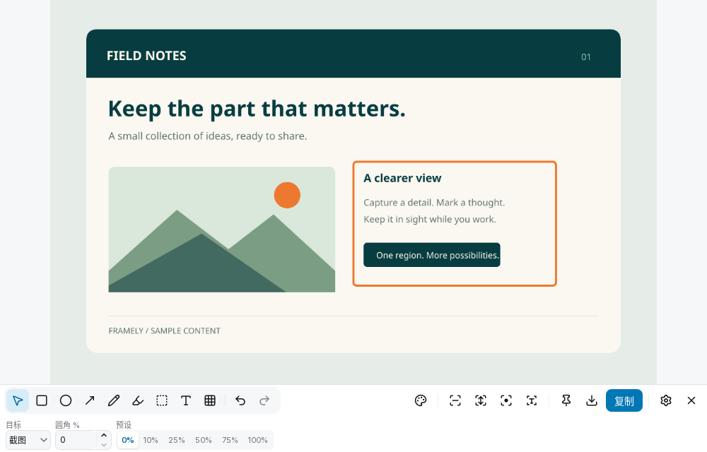

<p align="center"></p>

# Framely · 取景

截图、标注、钉图、长截图、录屏、取字与翻译，一个驻留托盘的桌面工具。

使用 **Go + MyGo 原生 UI** 构建，支持 Windows、Linux 与 macOS。框选一次，即可复制、保存、标注、钉住、录屏或识别文字；每张图片独立开窗，关闭后释放图片和编辑历史。

Framely is an open-source desktop tool for screenshots, annotations, image pinning, screen recording, offline OCR and translation. Built with Go and MyGo native UI for Windows, Linux and macOS. Feature availability varies by platform; see the limitations below.

[下载最新版](https://github.com/wildalley/framely/releases/latest) · [更新日志](CHANGELOG.md) · [使用说明](docs/NATIVE.md) · [问题反馈](https://github.com/wildalley/framely/issues)



## 功能

| 功能 | 用法 |
| --- | --- |
| 截图 | 框选后拖动、拉伸或用方向键微调；直接复制、保存，或进入标注。支持打开图片与粘贴图片。 |
| 标注 | 画笔、荧光笔、矩形、椭圆、箭头、文字与马赛克；支持颜色、粗细、透明度、圆角及撤销重做。 |
| 钉图 | 图片置顶显示，拖动移动、滚轮缩放；悬停显示操作栏，双击回到编辑。 |
| 长截图 | Windows / Linux 支持滚动拼接、暂停、撤回与完成；自动滚动取决于系统授权能力。 |
| 录屏 | 沿用截图选区或上次录制区域，支持 30/60 fps 无声 MP4、暂停与继续，以及视频转 GIF。 |
| 离线取字 | 内置中英文 OCR 模型；长图分块识别，支持中文分词、单字选择、拖动选词和组合复制。 |
| 翻译 | 取字后对照原文与译文；支持按需下载的离线中英模型，以及使用个人密钥的在线翻译服务。 |
| 取色 | 放大镜查看像素与颜色，复制 `#RRGGBB`；Windows / Linux 可使用独立取色器。 |
| 导出 | 复制到剪贴板，或保存为 PNG、JPEG、WebP；PNG / WebP 支持透明度。 |

录屏默认保存到系统「视频」目录下的 `Framely` 文件夹，可在设置中修改。录制控制条与托盘显示计时，结束后可导出 GIF。当前不采集系统声音或麦克风，平台实测范围见 [录屏说明](docs/RECORDING.md)。

## 下载与安装

当前版本为 **v0.4.2**，完整发行包包含屏幕采集、录屏和离线 OCR 组件，使用时无需另装 Go、Python 或 FFmpeg。离线翻译模型需在设置中单独下载。

从 [GitHub Releases](https://github.com/wildalley/framely/releases/latest) 下载对应平台的附件；发布页提供 `SHA256SUMS` 用于校验。

| 平台 | 附件 |
| --- | --- |
| Windows x64 | `framely-0.4.2-windows-amd64-setup.exe` 或 `framely-0.4.2-windows-amd64-portable.zip` |
| macOS 15+ · Apple Silicon | `framely-0.4.2-darwin-arm64.dmg` |
| macOS 15+ · Intel | `framely-0.4.2-darwin-amd64.dmg` |
| Ubuntu / Debian x64 | `framely-0.4.2-linux-amd64.deb` |
| Arch Linux x64 | `framely-0.4.2-1-x86_64.pkg.tar.zst` |
| 其他 Linux x64 | `framely-0.4.2-linux-amd64-portable.tar.gz` |

- **Windows**：运行安装器，或将便携 ZIP 完整解压后启动应用。
- **macOS**：打开 DMG，将 `Framely.app` 复制到「应用程序」。
- **Ubuntu / Debian**：执行 `sudo apt install ./framely-0.4.2-linux-amd64.deb`。
- **Arch Linux**：执行 `sudo pacman -U ./framely-0.4.2-1-x86_64.pkg.tar.zst`。
- **Linux 便携版**：解压后执行 `./install.sh`，之后从应用菜单或 `framely` 启动。

### 升级后仍显示旧版？

先从托盘选择「退出 Framely」，再启动新版。关闭图片或设置窗口不会退出托盘进程；应用采用单实例机制，旧实例未退出时，新启动的程序可能将操作交给旧实例。

若退出后仍打开旧版，请检查是否同时保留了开发安装、便携安装与系统安装，以及菜单、自启动和快捷键是否仍指向旧路径。Linux 用户目录中的同名 `.desktop` 文件会覆盖系统入口；终端运行 `framely --version` 只能确认该命令对应的版本，不能证明托盘中的进程已更新。

| 安装方式 | 新版程序位置 |
| --- | --- |
| Windows 默认安装 | `%LOCALAPPDATA%\Programs\Framely\Framely.exe` |
| macOS | `/Applications/Framely.app` |
| Linux deb | `/opt/framely/framely` |
| Arch Linux | `/usr/lib/framely/framely` |
| Linux 便携安装 | `~/.local/framely.app/framely` |

从早期 ScreenPin 版本升级时，配置会迁移到 Framely 目录，旧命令保留兼容入口。请完整更新应用和配套组件；迁移行为详见 [v0.4.2 发布说明](docs/releases/v0.4.2.md)。

## 快速使用

1. 启动应用，从托盘或截图快捷键开始框选。松开后可继续调整选区，在下方操作栏选择复制、钉住、标注、保存、长截图、录屏、取字或翻译。
2. 选区中按 **Enter** 直接复制，双击钉住，按 **C** 复制颜色值，按 **R** 恢复上次区域。
3. 在图片编辑窗口使用 `Ctrl/Cmd+C` 复制、`Ctrl/Cmd+S` 保存、`Ctrl/Cmd+W` 关闭。
4. 录屏可沿用当前选区，也可从托盘选择「录制上次区域」；录制中通过控制条或托盘暂停、继续、结束。
5. 取字后选择词语组合复制，或切换到「翻译」页查看原文与译文。

默认截图快捷键为 Windows **Win+Shift+S**、macOS **⌘+⇧+S**、Linux **Super+Shift+S**。已有配置保留原快捷键；快捷键占用及 Wayland 系统授权以设置页显示为准。

```bash
framely                    # 启动或唤起托盘实例
framely --capture          # 区域截图
framely --scroll           # 长截图（Windows / Linux）
framely --ocr              # 框选取字
framely --translate        # 框选后识别并翻译
framely --color            # 取色器（Windows / Linux）
framely --repeat           # 重复上次区域（Windows / Linux）
framely --record           # 沿用上次区域录屏；录制中再次调用结束保存
framely ./example.png      # 打开图片
framely --version          # 查看命令对应的版本
```

Linux Wayland 的截图、屏幕共享和快捷键由系统分别授权。niri 等桌面的配置步骤与完整快捷键见 [使用说明](docs/NATIVE.md)。

## 隐私与翻译

截图、标注和 OCR 在本机处理，不上传图片。OCR 中英文模型随安装包提供，无需运行时下载。

- **离线翻译**：在设置中主动下载中英互译模型，每个方向约 110 MB，下载时校验文件；安装后在本机推理，翻译时无需联网。译文质量通常低于在线服务。
- **在线翻译**：支持 DeepL、百度翻译、腾讯翻译君或兼容 OpenAI 的大模型接口。使用你填写的密钥，只向所选服务发送识别出的文字，不发送图片；未设置服务时不发送内容。
- **密钥与设置**：密钥保存在系统密钥库，普通设置保存在系统应用配置目录。Linux 保存密钥需要可用的 Secret Service，例如 GNOME Keyring 或 KWallet。

配置目录为 Linux 的 `~/.config/framely`（支持 `XDG_CONFIG_HOME`）、Windows 的 `%APPDATA%\Framely`、macOS 的 `~/Library/Application Support/Framely`。建议通过设置面板修改；卸载应用不会删除设置。

## 平台要求与限制

| 平台 | 要求与限制 |
| --- | --- |
| Linux | GTK3、AppIndicator、PipeWire 和适配桌面的 `xdg-desktop-portal` 后端；无需 WebKitGTK。发行包以 Ubuntu 22.04 或兼容运行库为基线。Wayland 下自动滚动取决于门户是否提供指针控制；取色和重复截图需要允许直接截图。 |
| Windows | 长截图使用 Windows Graphics Capture，要求 Windows 10 1903+；浮动控制窗口排除采集需要 Windows 10 2004+。 |
| macOS | 要求 macOS 15+；暂不支持长截图、独立取色器和重复上次区域。 |

Windows / macOS 安装包暂未配置正式开发者签名与公证。多屏、HiDPI、系统共享授权和硬件编码仍可能因桌面环境或设备而异；已验证范围见 [发布说明](docs/releases/v0.4.0.md)、[录屏说明](docs/RECORDING.md) 与 [资源检查](docs/AUDIT_2026-11-11.md)。

## 技术栈

| 层次 | 实现 |
| --- | --- |
| 应用与界面 | Go + [MyGo](https://github.com/egoist/mygo) 原生 UI，负责窗口、托盘、快捷键和图片编辑。 |
| 屏幕采集 | 平台原生组件：Linux PipeWire / XDG Desktop Portal、Windows Graphics Capture、macOS ScreenCaptureKit。 |
| 录屏与 GIF | 原生媒体组件与精简 LGPL FFmpeg。 |
| 离线 OCR | Python 工作进程、RapidOCR、PP-OCRv6-small 与 ONNX Runtime，运行时随发行包打包。 |
| 离线翻译 | Marian / OPUS-MT 中英模型、ONNX Runtime 与 SentencePiece。 |

核心依赖版本以 [`go.mod`](go.mod)、[`workers/ocr/requirements.txt`](workers/ocr/requirements.txt) 和 [`workers/ocr/rapidocr.in`](workers/ocr/rapidocr.in) 为准。

## 开发与构建

需要 **Go 1.27.3+**。完整发行包还需要 `uv`，构建脚本会准备 Python 3.12 环境和组件依赖；各平台原生组件需在对应系统构建。

```bash
git clone https://github.com/wildalley/framely.git
cd framely

# Go 测试与静态检查
go test -race ./...
go vet ./...

# 构建当前平台的采集、媒体与离线 OCR 组件
python3 scripts/build-components.py

# Linux x64 完整包示例
go tool mygo build -platform linux/amd64 -skip-installer -skip-dmg -skip-notarize
python3 scripts/package-release.py
```

组件输出至 `resources/<系统>-<架构>/workers/`，应用包位于 `build/native/`，发行附件位于 `build/release/`。仅交叉编译 Go 主程序不能得到完整发行包。

组件构建完成后，可在源码目录运行：

```bash
export FRAMELY_COMPONENTS_DIR="$PWD/resources/$(go env GOOS)-$(go env GOARCH)/workers"
go run ./cmd/framely
```

Linux 需要 C 编译器、`pkg-config`、PipeWire / VAAPI 开发库；媒体构建另需 bash、make 和 NASM（x64）。Windows 使用 Visual Studio x64 Native Tools、Windows SDK 与 MSYS2；macOS 使用 Xcode。完整步骤见 [开发说明](docs/NATIVE.md) 与 [媒体构建说明](docs/RECORDING.md)。

## 文档与贡献

- [使用与开发说明](docs/NATIVE.md)：平台配置、快捷键、构建和集成测试。
- [OCR 流程](docs/OCR_WORKFLOW.md)：取字交互、模型复用和长图处理。
- [录屏说明](docs/RECORDING.md)：采集、编码、GIF、依赖及验证范围。
- [更新日志](CHANGELOG.md) · [改进记录](IMPROVEMENTS.md)。
- [图标与品牌](docs/BRAND.md)：SVG 母版、生成方式和设计来源。

反馈问题时请附操作系统、桌面环境、应用版本与复现步骤；截图请先移除私人内容。

## 许可证

项目采用 [MIT](LICENSE) 许可证。发行包保留第三方依赖、分词词典、图标与模型的许可证。录屏组件使用精简 LGPL FFmpeg，随包提供对应源码、构建配置和许可证，详见 [录屏说明](docs/RECORDING.md)。
