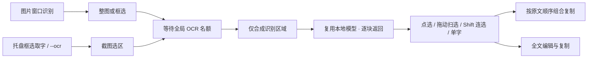

# OCR 流程与词块选择

2026-11-10，本地开发改动，尚未发布。继续使用 RapidOCR 3.9.2 / PP-OCRv6-small CPU 模型；此次优化集中在流程、运行时复用和结果交互。

## 使用流程

- 中文使用本地词频表分词；英文、版本、数字、邮箱和网址尽量不拆开。
- 全选复制保留原始空白与换行；跳选英文词时补空格，跨行选择保留换行。
- 识别进度中的选中内容会尽量保留。插入新行时匹配未变化的独立文本行；无法确定身份的重复行不自动选中。
- 单字模式用于精确选取；只选中词的一部分再切回分词时，不会额外选中整个词。
- 鼠标拖动扫过词块可连续选中；从已选词块开始则连续取消。同一手势划回不会反复切换，快速移动会检查两个指针采样点之间经过的词块。保留点击、Shift 连选和方向键/空格；列表滚动后按实际可见位置命中，进度更新、切换分词模式/页签或关闭会终止旧手势。
- 大量词块使用虚拟列表；结果合并和分词在识别线程执行，UI 只更新文字和选中状态。
- OCR 无磁盘结果缓存，不上传截图；关闭结果窗口释放文字、词块、列表和回调，关闭来源图片也会取消识别。

## 资源与协议

全局单任务队列在图像合成之前获取名额。框选后只创建选区大小的 RGBA，保留当前标注、马赛克和整图圆角。透明像素在发送前合成白底，隐藏的原图像素不会进入识别。

protocol 2 使用 16 字节请求头：`SPO2`、小端 uint32 宽、高、RGB 字节数；之后逐行传输 RGB。响应为小端 uint32 JSON 长度和 JSON，分为 `progress` 与 `result`。worker 的 `--server` 模式首次请求加载模型，之后复用；未带参数时保留旧 PNG 单次诊断入口。

边界：32768 最大边长、32 MP、3 分钟超时（含排队）、20000 文本行、2 MiB 文本；响应单帧最多 16 MiB，总计 32 MiB、最多 1024 条消息，stderr 诊断最多 16 KiB。输入尺寸在 Python 分配像素之前检查。无效输出、取消、超时或退出会杀死并回收子进程，下次重新启动；正常完成后空闲 45 秒退出。复用期间模型内存会驻留，这是减少加载耗时的取舍。

分词词典压缩 338279 字节，按需解压；采用 jieba MIT 许可词频表的 60000 个词，并加入少量截图相关词。发布组件带有 `LICENSE.jieba`。

## 本机验证

Linux amd64，Intel Core Ultra 7 265KF。下面是同一次集成测试的观测值，不能视为其他机器或图片的延迟保证，也不与旧版端到端耗时直接比较。

| 样例 | 耗时 | 结果 |
| --- | ---: | --- |
| 中英文样例首次识别 | 449 ms | 3 行、1 次区块进度 |
| 同一图片复用模型 | 78 ms | 3 行、1 次区块进度 |
| 2000 × 2200 分块长图 | 3.24 s | 18 行、4 次区块进度 |
| 500 行混合文本分词基准 | 1.21 ms/op | 约 1.40 MB/op，5027 次分配 |

测试覆盖词块点选/Shift 连选、单字切换、复制与编辑、进度与取消、关闭时词块弱引用回收、400px 窄窗口与深浅色、大字体；图像测试逐像素比较选区与整图导出的裁剪，包含非零原点、标注、马赛克和圆角。子进程测试覆盖复用、空闲回收、队列取消、启动后取消、无效帧后重启、RGB 步长与透明像素。Python 单测覆盖请求边界、截断输入和模型复用。

后续内存预算、组件加载加固和拖动扫选的验证见 [优化检查记录](AUDIT_2026-11-10.md)。UI 使用 MyGo 无窗口渲染检查，未进行 Windows/macOS 真机交互验收；Go 堆回收结果不代表已经排除所有原生/GPU 资源泄漏。

## 尚未实现

原生 ONNX / 系统 OCR 后端、量化模型、原图文字框联动、结构化表格导出、拖动到列表边缘自动滚动和有界结果缓存尚未实现。替换 Python/OpenCV 才可能显著缩小完整组件；需要中英文、长图、复杂版式的质量对比及三个平台的运行时验证，不能仅根据模型文件大小决定替换。
